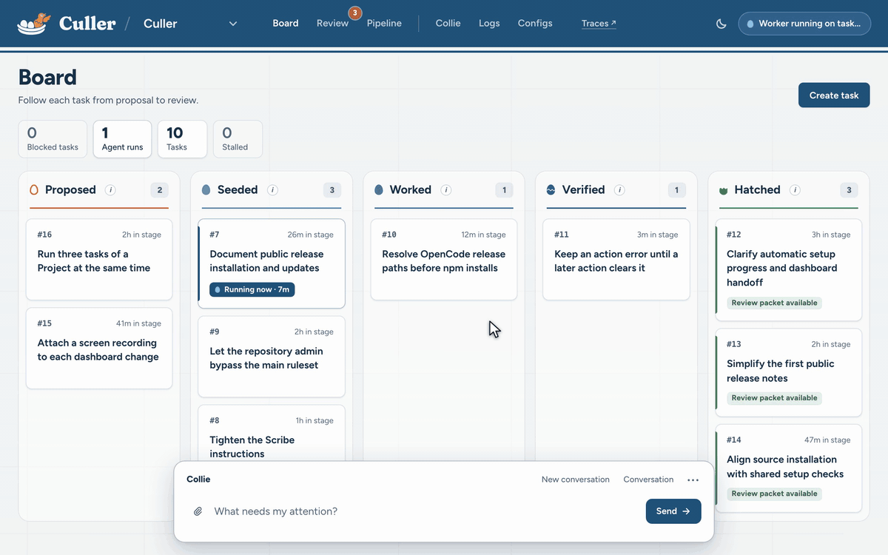

**Software factory at home**

S-Horizon is a project factory that runs on your own Mac. You own the factory, the code, and the final say. Its agents work toward your vision, on your repositories, through any AI provider.


[Features](#features)  ·  [Install](#quick-install)  ·  [The factory line](#the-factory-line)  ·  [Architecture](#architecture)  ·  [Security](#security)

---

## Philosophy

Attention is sacred they say. S-Horizon helps build projects with that in mind.

You define a **vision** that states your project's open-ended, high-level goal and S-Horizon proactively proposes and submits high-leverage work toward your stated intents.

Additionally, you can define new work yourself or with the help of Collie, your S-Horizon assistant.

You can review, propose, reject, and otherwise **cull** work as agents move tasks along the factory line.

---

## The factory line

You can import an existing project or start one from scratch.

### Review only validated work

Five roles run in order, with one agent run at a time for each Project.

1. **Strategist** proposes high-leverage task candidates to advance your vision.
2. **Arbiter** judges each proposal and promotes the most effective one.
3. **Worker** works the task in its own repository copy and submits one commit.
4. **Verifier** checks the work against acceptance criteria and asks Worker to correct any gaps.
5. **Packager** creates a *review packet meant for a human mind.*

One packet for each decision.

---

## Features

**Proactive work.** S-Horizon does work in between your decisions.

**Illustrative review packets.** Maintain effective command of your projects by never losing picture of them.

**Openwiki.** S-Horizon creates and maintains a wiki for each project, maintained by a scheduled agent named **Scribe**. It serves three purposes:

1. Acts as index into the repository's ground truth for agents to enable more efficient search.
2. Acts as a knowledgebase to help the Strategist prioritize work.
3. Provides a viewer so you can re-familiarize yourself with your project as it continually develops.

**AgentsView.** A trace viewer for agent observability.

**Prepared environments.** When you start a project, the setup agent prepares the Project dependencies and reports each environment limit.

**Tried and trued harnesses.** S-Horizon leverages frontier lab and community vetted harnesses (Codex, Claude Code, OpenCode). Any gains they acquire, S-Horizon acquires in subsequent releases. 

**Multiple Projects.** Different Projects run at the same time.

**Discord Integration.** Keep in tandem when you're away from your work device. Talk with Collie from Discord and get alerts about blocked tasks. Optional.



---

## Quick Install

### One script installs S-Horizon and guides the setup.

```sh
curl -fsSL https://raw.githubusercontent.com/warlockedward/Culler/main/install.sh | bash
```

The terminal setup has four main steps:

1. Installs dependencies
2. Connect an Agent
3. Start S-Horizon
4. Open your dashboard

Setup asks for your approval before it starts S-Horizon services.
Then you add your first Project in the dashboard.

## Architecture

**Each agent runs in a sandbox.
Host services and the dashboard run on your Mac.
A proxy ensures AI provider credentials don't reach agents.**

![FIG. 3, architecture. On your Mac, the Browser opens the dashboard. The dashboard reaches AgentsView through a local proxy and serves OpenWiki. The dashboard and the resident run mc. mc reaches the db through docker exec and the helper container. Inside Docker Desktop, the db is one SQLite database in a named volume. The resident starts each agent container. Each agent container runs mc inside the container and reads and writes the db. The Project repositories supply a fresh source workspace for each run, mounted at /workspace/source, and keep the result commit after the run. Provider credentials stay in the macOS Keychain. mc reads them for the provider proxy in the resident. Agent containers send model requests with a temporary platform token to the proxy. The proxy adds the credentials and sends each request to the model provider. Agent containers hold no provider credentials. Discord is optional.](docs/architecture-dark.svg)

One program writes to the db.

- `mc` (Mission Control) is the Go command cli for S-Horizon agents. It owns dispatch, and mission control state management. It is the only writer of the db. It is agent facing, not intended for direct interaction by users.
- **The db** is one SQLite database in a Docker named volume. Triggers and CHECK constraints refuse illegal states.
- **The resident** is the host daemon. It runs one dispatch tick every 60 seconds by default. It starts the containers that that need to run next. Its provider proxy adds the provider credentials to each model request.
- **The dashboard** is the web interface at `127.0.0.1:7333`. It runs `mc` for each db read and write.
- **Agent containers** start fresh for each run. The runner starts the agent harness with the Project tools. Each run works in a fresh source workspace of the Project repository at `/workspace/source`. A container holds a temporary platform token and no provider credentials. The Project home at `/home/agent` and the `/cache` folder carry over between runs.
- **The macOS Keychain** holds the provider credentials. `mc` reads them on the host for the provider proxy.
- **AgentsView** shows the trace of each agent session at `127.0.0.1:7334`.
- **OpenWiki** shows the wiki of each Project. The dashboard serves it at `127.0.0.1:7335`.

launchd keeps the three host services alive: the resident, the dashboard, and AgentsView.

## Security

**All agents run in sandboxed environments via Docker Desktop.**

**Process isolation** — agent containers run in the Docker Desktop Linux virtual machine, with every root privilege dropped.

**Filesystem isolation** — only Project and S-Horizon administrative folders are mounted into containers. No other host files are touched.  

**Non-root execution** — agents run as the unprivileged user 10002  

**Per-run containers** — each pipeline run and setup operation gets a new container, and each Collie conversation gets its own.

S-Horizon allows for the following at the moment:

- Agent containers have open internet access.
- Agent containers can reach any service on the loopback address of your Mac. S-Horizon's own services require a token or a secret path.

---

## Requirements

- A Mac with Apple silicon.
- Docker Desktop, installed and running. Setup checks it but does not install it.
- Git, mise, and Bun. The installer installs each one that is absent.

---

## Roadmap

**S-Horizon is in early release**.

For v1 the targets are:

#### Worksources and MCPs

Give agents the ability to query data from additional services.

Instead of seeding work only from your Vision, also use connected data sources such as Github Issues, Linear, Gmail etc. that act as *Worksources*.

Have Scribe use these supplemental data sources to help curate the project's OpenWiki knowledgebase over time to better develop strategy.

#### More effective agents

Particularly Strategist/Arbiter and Packager provide most of S-Horizon's distinct agent value.

Benchmark and run GEPA ([https://github.com/gepa-ai/gepa](https://github.com/gepa-ai/gepa)) optimization against each agent's directive.

#### Pluggable custom agent roles

Instead of Strategist alone proposing work, define custom agent roles.
Maybe roles like: Trimmer - to identify unused code, Optimizer - to target performance enhancement, etc.

#### Quality of life

Just make S-Horizon more pleasant and reliable.

---

## Derived from Culler

S-Horizon is a fork of **Culler**, created by Vincent Santos (<https://github.com/vinchenkov/Culler>), distributed under the MIT license. The upstream copyright and license notice are retained in full in [LICENSE](LICENSE). `mc`, `spine`, and the `MC_*` environment names remain internal engineering codenames of the upstream design. See `docs/BRAND-WHITELIST.md` for every place the upstream name legitimately remains.

## License

[MIT](LICENSE)

---
